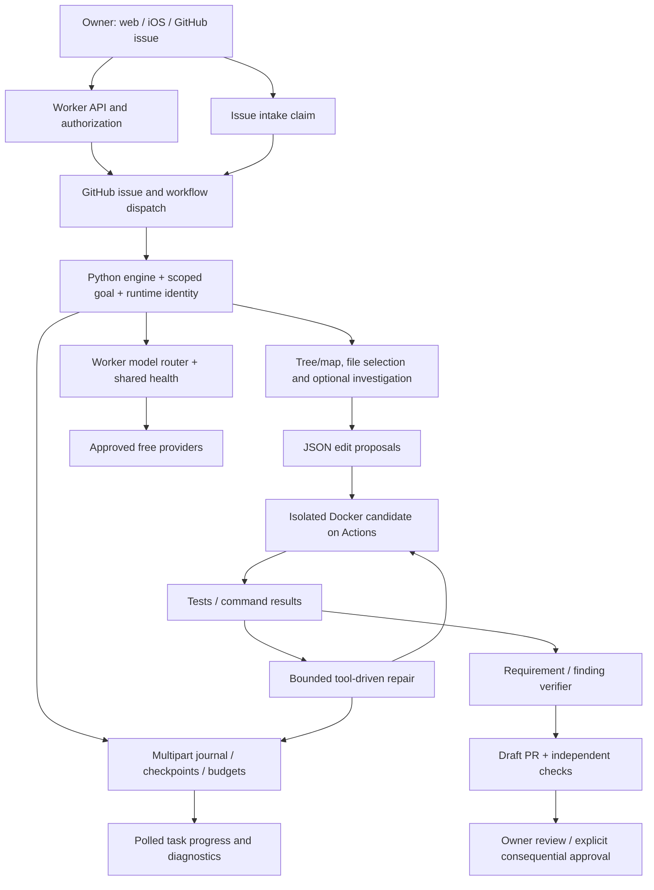
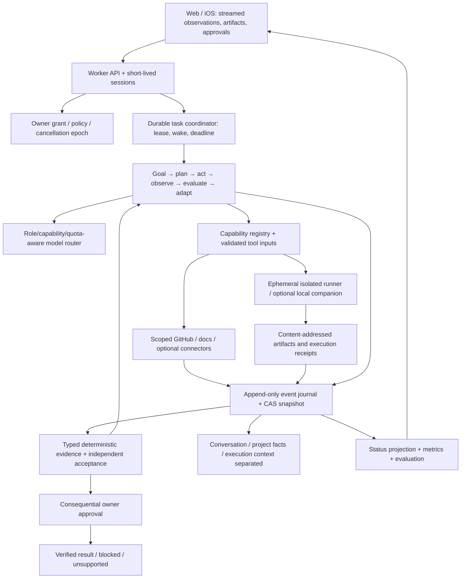

# Current and target architecture

Audit snapshot: 2026-10-30 UTC. Default branch `main`, commit `19c95923d12156688487fd8d4e1f6dd1c16eefa6`. Documentation-only branch `audit/autonomy-2026-10-30`. No inference requests, workflow dispatches, merges, releases, deployments or production configuration changes were made by this audit.

Evidence labels: VERIFIED = directly observed implementation or execution (the evidence specifies which); PARTIAL = implementation exists with material limits; BROKEN = observed failure or deterministic incorrect behavior; MISSING = no implementation found in the inspected execution surfaces; UNVERIFIED = insufficient execution/access evidence; NOT APPLICABLE = outside the declared supported scope. Source verification is not production verification.

The current system already has a genuine iterative coding execution loop, isolated compute, free-route fallback, authority enforcement and resumable state. It is a hybrid: fixed initial edit proposals, optional tool-driven investigation, sandbox-driven repair and separate model-based verification. It is not a general autonomous operating environment.

| Subsystem / purpose | Implementation | Input → communication → output | Preserved state | Failure handling | Tests / practice evidence | Classification / gaps |
|---|---|---|---|---|---|---|
| Web/native frontend | preview/index.html,app-main.js,app-state.js,app-tasks.js; ios/KappaForge | Owner text, attachments, settings → /chat, /authorize, task controls → streamed reply and task cards | Local chats/preferences, encrypted sync; polling progress | Freshness/blocked messages, retry/cancel controls | Node UI/state tests; check-web passed; native live UNVERIFIED | PARTIAL; KF-AUDIT-042–046 |
| API/auth/authority | chat-backend/src/index.js,intent-guard.js,operation-contract.js | Bearer request + explicit operation grant → route handlers/DO → response or denial | DO authorization IDs, expiry, request receipts | Fail-closed grant/replay checks; 401/403/409 | Node intelligence/authorization tests; deployed scopes UNVERIFIED | PARTIAL; KF-AUDIT-035–041,052 |
| Cloudflare inference gateway | inference-router.js,routing-policy.js,providers.js | Coding/chat messages + role + constraints → eligible providers → normalized reply/usage | DO route cooldowns, quotas, request IDs | Reservations, bounded timeouts, error normalization, fallback | 924 Node pass; #330 fallback actually observed | PARTIAL; KF-AUDIT-016–021 |
| Task intake | scripts/task_intake.py; .github/workflows/task-intake.yml | Owner issue opened/labeled → claim → agent workflow_dispatch | Bot claim keyed to issue creation | Dedup claim, author/label/scope checks; event case caveat in report11 | Intake tests; actual #330 run chain | VERIFIED; KF-AUDIT-009,036 |
| Engine entry/task modes | engine/runner.py,task_scope.py,task_goal.py | Authorized issue + pinned ref → scoped mode → developer/read/report | Goal digest, execution scope, provider usage | Scope checks and failure reports; standalone provider fallback retained | Python suite; newest code job and loaded KAPPA guidance | PARTIAL; KF-AUDIT-011,060 |
| Planning and exploration | developer.py:select_files,plan_change; exploration.py; repo_map.py; task_plan.py | Repo tree/map, guide, task → chosen files/questions/stages → source context | Plan, research citations, investigation spend | Bounded tools, source-unavailable fallback; silent requirement cap | Python exploration/requirements tests; 30/40 probe | PARTIAL; KF-AUDIT-004,014 |
| Initial edits | developer.py:generate_with,apply_changes; export_index.py | Task/context → JSON file edits → validated candidate | Generation checkpoint, previous errors/proposals | Up to five proposals; reread-source hints, import/syntax/path checks | Python developer/export tests; #330 one-file candidate | PARTIAL; KF-AUDIT-007,011,013 |
| Iterative tool repair | sandbox_repair_controller.py; tool_loop.py; sandbox_tools.py | Failure/diff/history → JSON tool → actual result → next inference | Controller phase, attempts, hypotheses, read evidence, patches | Invalid/repeated-call/action/attempt budgets, final fresh regression | Local tool-loop suite; #322 live dynamic reads and invalid_limit | PARTIAL; KF-AUDIT-007–013 |
| Sandbox/terminal | engine/sandbox.py; infrastructure.py | Candidate archive + trusted profile → Docker command → stdout/stderr/exit/diff | Patch, test receipts, isolated dependency volumes per run | No network test profile, no env credentials, caps, unprivileged/read-only root | Real prior #330 sandbox receipts; local Docker checks not run | PARTIAL; KF-AUDIT-033–034 |
| Requirements/review | requirements.py,verify.py,repair_guard.py,operational_review.py | Original requirements + candidate + receipts → findings/matrix → repair or block | Finding IDs, rejection history, source citations | Literal quote and exact-candidate checks; incorrect evidence type can block | #330 source-scope failure; #323 copied-logic test accepted | PARTIAL; KF-AUDIT-001–004,058 |
| GitHub publication | developer.py:publish_candidate,move_branch; commit_provenance.py | Validated candidate + scoped token → draft commits/PR and test dispatch | Branch origin, expected candidate, publication receipt | CAS-style ref checks, draft stays draft; workflow token special path | #331 open/draft/one changed file; no merge observed | PARTIAL; KF-AUDIT-009,035,053 |
| Fix/review ingestion | review_repair.py,review_ingestion.py,review_graph.py; review.js | Original task + authenticated PR feedback/checks → exact-head repair | Revision metadata, feedback IDs, reviewer snapshots | Fail-closed incomplete inventories; stale/closed branch stops | #322 Fix observed; #320 pending review-ingestion branch | PARTIAL; KF-AUDIT-002,007–009 |
| Persistence/resumption | recovery.py,execution.py,generation_checkpoint.py,runtime_engine.py | Scoped saved journal + candidate → reconstructed execution | Multipart bot comments, candidate patch, budgets, engine receipts | Hashes, authority/ref binding, bounded continuation and archived history | Python resume tests; #322 retained exact candidate; kill tests unrun | PARTIAL; KF-AUDIT-005–006,022–024 |
| Background coordination | recovery-wake.js; recovery.yml; task_queue.py | Timers/pending task → leased/authorized dispatch → continuation | DO alarms and GitHub queue/journal | Cooldown/deadline checks; finite budgets, expiry | Unit evidence; latest scan success ≠ objective success | PARTIAL; KF-AUDIT-010,054 |
| Memory/project knowledge | app-state.js; project_memory.py; vector-index.js | Saved notes/chat/index report → retrieval/context + encrypted vault sync | LocalStorage/IndexedDB, DO vault/vectors, issue snapshots | Vault revisions; invalid snapshots rejected; bounded retrieval | Node vector tests; two-device continuity not executed | PARTIAL; KF-AUDIT-025–027,041 |
| Research | engine/research.py; config/research-hosts.json | Allowed docs query/URL/package → HTTP GET → text, examples, citation | Bounded fetched pages, research budget | Host/redirect controls, private-query constraints, time/byte budgets | Research unit fixtures; general internet research MISSING | PARTIAL; KF-AUDIT-028 |
| Artifacts/multimodal | voice.js; preview attachment paths; native build evidence | Audio/media/files → provider-specific request/build artifacts → output | App attachment state and artifact manifests | Format/model limits; provider failures | Media reasoning and office artifacts UNVERIFIED/MISSING | PARTIAL; KF-AUDIT-030,059 |
| Accounting/diagnostics | router-state.js,router-coordination.js,premium*.js; task_state.py | Request reservations/results → usage, budget and error events | DO quotas/cooldowns, ledger comments, provider usage | Idempotence, prepaid reservation/refund/reconcile; sparse budget defect | Node quota tests, #330 measured response tokens | PARTIAL; KF-AUDIT-005,018–021,050 |
| CI/deployment | tests.yml,deploy-chat.yml,ios-build.yml,sandbox-tests.yml | Commit/PR or authorized dispatch → tests/build/deploy jobs → receipts | GitHub runs/artifacts; Cloudflare deployed config outside repo | Required assertions and environment declarations; gates not confirmed | Python/Node/check-web/policy/map/dry-build locally passed | PARTIAL; KF-AUDIT-048–053 |
| Parallel execution | developer.py:waves; multi-agent-check.yml | Disjoint stages → bounded workers → reconciliation/review | Shared task plan/context, stage checkpoints | Stage conflict constraints and overall budgets | Source observed; independent multi-agent acceptance UNVERIFIED | PARTIAL; KF-AUDIT-055 |

## Actual autonomy stages

Understand: narrow natural-language requests and requirement classification exist (PARTIAL, 30-item loss). Plan: stages, research questions, task plans exist (PARTIAL). Act: real source edits, Docker tests, GitHub APIs exist (VERIFIED narrow workflows). Observe: command and tool results return to model/controller (VERIFIED #322 read tools and failed-test receipts). Evaluate: exact candidate tests and source review exist (PARTIAL, wrong evidence types). Adapt: reread/source strategy and tool loop exist (PARTIAL, repeated failed anchors). Verify: real tests plus independent checks exist (PARTIAL, copied test weakness). Complete: draft delivery exists (PARTIAL, no uniform objective terminal state).

Pause/resume and ask_owner are present with retained checkpoints and scope. General restart durability and approval resumption across all side effects remain UNVERIFIED. Safe termination is bounded by tool/model/action budgets; done:true is not itself an independent success proof. Tool exceptions become structured errors; model failures flow to the recovery controller. The observed system is not single-attempt-only, and not every stage is restricted to the planner's initial files.

## Target design: consolidate contracts, retain useful components

Minimal infrastructure: retain Cloudflare Worker + existing Durable Object for auth/router/coordinator; initially retain GitHub Actions as the Docker execution host and GitHub as publication surface. Use object storage only if journal/artifact volume requires it and costs are approved. A DO-backed event table with sequence/CAS is an incremental option; storing everything in a mutable issue comment is not an atomic journal. Export summaries to issues for owner review. Do not add a vector database or persistent GPU server by default.

Workers can authenticate, perform HTTP/API requests, coordinate DO alarms and route models. **A standard Cloudflare Worker cannot safely provide unrestricted POSIX command execution, Docker or a general browser process.** Existing Docker execution is on GitHub-hosted runners. Browser/office/test tooling needs that isolated compute or optional remote compute; local files/desktop actions need an explicitly installed local companion. No additional compute is needed for cloud chat, API calls and allowlisted docs. Workers browser/container services are optional separate products with availability/billing constraints, not implied by the existing Worker.

Tool contract: registered version/schema, purpose, capability tags, resource scopes, side-effect class, input validation, idempotency key, expected state/version, timeout, cancellation epoch, structured output, redaction policy and immutable receipt. Observation contains execution ID, actual status, exit/error category, timestamps, stdout/stderr artifact IDs, changed files, usage, validation and authority reference. A model can request actions but cannot mint grants, execution receipts or success. General API/network tools require destination allowlists and response-to-authority separation.

Retention proposal requiring owner decision: full execution receipts 90 days (longer pinned incidents), active task checkpoints until completion +30 days, artifact/log blobs 30 days unless pinned, minimal task result and authorized project decisions until deletion, conversations under owner-selected retention. Secrets never enter journal/prompts; private repository evidence remains private; sync ciphertext and execution evidence have separate deletion procedures. Cross-device retrieval is not a substitute for a durable execution journal.

Migration: (1) typed evidence and terminal receipt wrapping current controllers; (2) append events beside existing comments and shadow-compare reconstruction; (3) route current planning/edit/repair calls through one action protocol; (4) move authoritative snapshot to atomic store with old-comment import; (5) expand tool adapters. Retain sandbox.py, provider adapters, policy guards, project maps, export index and working UI components. Redesign verify.py evidence contract and distributed state projection; consolidate Python/JS twins via schemas/conformance tests, not by forcing one runtime. Retire legacy fixed modes only after equivalent fixtures pass. Do not run candidate engine/workflow code with secrets simply because its draft is unmerged.

Parallelism: serial default. Useful optional roles are read-only researcher, isolated test runner and independent verifier; coding workers only for disjoint change sets. Require workspace per child, explicit owner goal and constraints, write ownership, conflict detection, aggregate budget, failure isolation and parent acceptance. More agents neither produce flagship intelligence nor solve shared quota exhaustion. Defer planner/coder/debugger swarms until serial reliability is measured.
