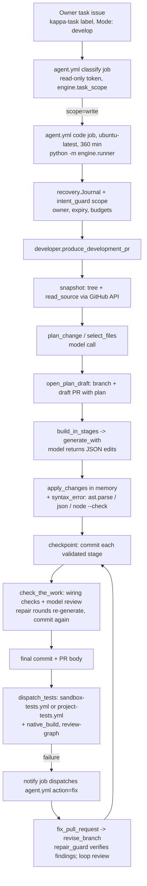
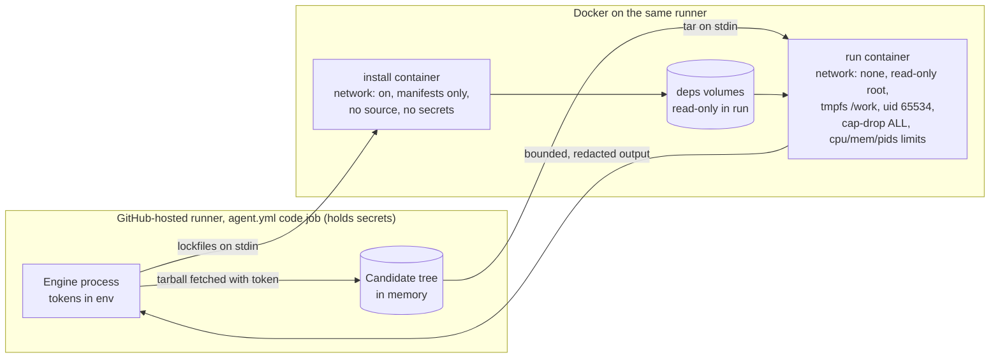

# Execution architecture (Phase 1, step 1)

Investigated on `main` at `1d9bdc8` (after #223, #224 and #225). This records how KappaForge executes a development task
today, every security control on that path, and where the Phase 1 sandbox fits. Phase 1 keeps this flow and its controls,
and adds pre-commit execution inside it.

## Today's execution path

What is executed, and where:

| Step | What runs | Where | Before or after commit |
| --- | --- | --- | --- |
| `syntax_error` (`engine/developer.py`) | `ast.parse`, `json.loads`, `node --check` on a temp copy | Agent job, on the runner | Before |
| `verify.wiring_problems`, `structural_scan` | Static analysis only (ast-grep, JS analysis) | Agent job | Before |
| Model review (`verify.model_review`) | Inference only | Gateway | Before, on committed checkpoints |
| `sandbox-tests.yml` (KappaForge) | `unittest`, `compileall`, `check-web.py`, `node --test` | Separate workflow, no secrets, `contents: read` | **After**: dispatched with the committed `candidate_sha` |
| `project-tests.yml` (other repos) | Detected test command (KAPPA.md, npm, pytest/unittest, go, cargo) | `fetch` job holds a token, `verify` job runs with `permissions: {}` | **After** |
| `ios-build.yml` (`native_build`) | Xcode build, simulator, unsigned IPA | macOS runner | **After** |
| `tools/multi_agent_check.py`, `tools/lifecycle_simulation.py` | Generated code in Docker: `--network none --read-only --cap-drop ALL --user 65534` | Simulation workflows only | Not part of real tasks |

The cost Phase 1 removes: every real test result needs a commit, a workflow dispatch, a runner start and a log
download. A failure then reaches the engine again only through `notify -> agent.yml action=fix`, which starts a new agent
run from `main`. One repair round is several minutes of wall time, a new commit and a fresh model context.

## Persistence and retry architecture

- **Recovery journal** (`engine/recovery.py`): per-task state in a `KAPPA_RECOVERY_V1` issue comment: candidate SHA, base,
  PR, files, requirements, budgets, events, `taskRecord`. `Journal.checkpoint` / `defer` / `stop` and the trusted
  recovery queue resume interrupted runs (`agent.yml` cancellation handling).
- **Task state** (`engine/task_state.py`): controller-owned record given to every model call: identity, receipts,
  stage, attempts, inference events, review, repair assessment. Candidate changes invalidate in-flight edits
  (`CandidateChanged`).
- **Budgets** (`engine/reliability.py`, `config/projects.json`): `edits 120`, `modelCalls 160`, `fixCycles 12`;
  `TOTAL_RECOVERIES 40` (`engine/intent_guard.py`); `MAX_CHECK_ROUNDS`, `MAX_FIXES`, premium rescue once per step.
- **Deadlines** (`engine/runner.py`): 5 h 50 min task budget (`TaskTimeExpired`), 240 s per model call
  (`MODEL_DEADLINE`), job timeout 360 min.
- **Repair verification** (`engine/repair_guard.py`, #224): findings are verified before they authorize edits;
  repeated/alternating attempts are fingerprinted and get one loop review.
- **Provider routing** (`engine/runner.py`, `engine/gateway.py`): integrated Worker gateway (`KAPPA_ROUTER_REQUIRED`),
  direct providers otherwise, free-first with an owner-gated premium rescue; pinned routes have tighter prompt caps.

## Security controls on the path (all preserved)

1. **Authorization**: owner login, `kappa-task` label, exactly one `Mode:` line (`engine/task_scope.py`), expiry and
   continuation limits (`engine/intent_guard.py`), allowed repositories (`config/repositories.json`,
   `runner.allowed_repo`, `config/projects.json` branch patterns).
2. **Token scoping**: `classify` uses a read-only token; only the `code` job gets write scope; other repositories use
   `KAPPA_CODER_TOKEN` through `projects.access`; `push_token` picks the token by path (workflow files need the
   `workflow` scope).
3. **Path and content guards**: `check_path` (no `..`, absolute paths, `.git/`), `change_flags` (secrets, auth, process
   execution, outbound URLs) stop for owner approval; `workflow_flags` call out secret use and write grants.
4. **Owner goal** (`engine/task_goal.py`): scope, exact comment deltas, file reasons, lifecycle handling.
5. **Test isolation**: test workflows run without API secrets; `project-tests.yml` separates the token-holding fetch
   from the secret-free verify job; `ios-build.yml` verifies the checked-out SHA.
6. **Never merge/release**: drafts only; `allowRelease: false`; the owner merges.
7. **Redaction**: `recovery.clean` removes secret-named environment values from stored text.

Gap Phase 1 must not open: the `code` job's environment holds `GITHUB_TOKEN` (write), `KAPPA_CODER_TOKEN`,
`KAPPA_ROUTER_TOKEN` and the Discord webhook. Candidate code must therefore **never** run as a child process of the agent.
`syntax_error` is safe today only because `node --check` parses without executing.

## Phase 1 placement

- **Infrastructure**: the existing `agent.yml` `code` job on `ubuntu-latest`, which already includes Docker. No new
  service, runner type or paid capacity. If Docker is missing, the task stops with an explanation
  (`SandboxUnavailable`); it never falls back to running candidate code on the runner.
- **Credentials**: the engine fetches the exact revision with its token, outside any container. Containers get an
  explicit, fixed environment; the runner's environment, Docker socket, Git credentials and `.git` are never passed in.
- **No commits**: edits change the in-memory candidate. Each command gets a fresh copy of it on a size-limited tmpfs.
  Nothing in a container can push, and the engine commits only after validation (step 4).
- **One image**: a local image built offline from the official `python:<v>-slim` and `node:<v>-slim` images, because
  polyglot projects such as KappaForge call `node` from Python tests.

## Sandbox threat model

Assets: the agent's GitHub tokens and router token, private source, the runner, the owner's repositories, and the honesty
of validation results.

| Threat | Mitigation |
| --- | --- |
| Candidate or test code reads secrets | No host environment passed; fixed env allowlist; no mounts of runner home, `.git`, credentials or Docker socket; tested by printing the container environment |
| Exfiltration over the network | Run containers use `--network none`. Install containers have network but receive only manifests and lockfiles, never source |
| Malicious install scripts | `npm ci --ignore-scripts`; pip `--only-binary=:all:` (no `setup.py` builds); installs need a lockfile or requirements file |
| Escape or privilege escalation | Non-root uid 65534, `--cap-drop ALL`, `no-new-privileges`, read-only root, default seccomp, `--init`, pids limit |
| Resource exhaustion | Per-profile CPU, memory (swap disabled), pids, tmpfs sizes, open-file ulimit, wall-clock timeout with `docker kill` |
| Output flooding or secret echo | Output kept as bounded head plus tail; token patterns and secret-named environment values redacted |
| Path traversal from the repository archive | Archive entries must be regular files under the expected `owner-repo-<sha>` root; links, devices and `..` are skipped |
| Repository widens its own permissions | Profiles, images and network settings come from engine code, not repository files; repository-named commands must pass the same allowlist |
| Faked validation | Test commands come from the base revision (KAPPA.md, `package.json`, Python layout). A candidate that changes its own test definition is flagged |
| Leftover state between tasks | Containers and volumes are labelled by session and removed on close; each command starts from a fresh tmpfs copy |
| Unsafe fallback | Missing Docker or an image pull failure (for example a Docker Hub 429) stops with `SandboxUnavailable` |

Residual risks: shared runner kernel (container isolation, not a VM); Docker Hub pull rate limits on shared runner IPs;
install containers can reach package registries; resource limits rely on cgroup support on the runner.

## Operating limits (step 2 defaults)

| Profile | Network | CPUs | Memory | pids | /work tmpfs | /tmp tmpfs | Timeout | Output kept |
| --- | --- | --- | --- | --- | --- | --- | --- | --- |
| `check` | none | 1 | 512 MB | 128 | 512 MB | 64 MB | 120 s | 64 KB |
| `test` | none | 2 | 2 GB | 256 | 1 GB | 256 MB | 900 s | 200 KB |
| `install` | bridge | 2 | 2 GB | 256 | manifests only | 512 MB | 600 s | 64 KB |

Repository archive: 200 MB maximum, 5 MB per file; dependency volumes are checked against 2 GB after install.
GitHub-hosted runners for private repositories have 2 vCPUs, 7 GB RAM and 14 GB disk, so the `test` profile fits with headroom.

## Step 2 implementation: `engine/sandbox.py`

| Piece | What it does |
| --- | --- |
| `fetch_revision(repo, sha, token)` | Allowed repository and full SHA only; downloads that revision's tarball with the engine's token (never passed to a container) |
| `Tree.from_tarball` | Keeps regular files under the expected `owner-repo-<sha>` root; skips links, devices, `..` and `.git/`; 200 MB / 5 MB limits |
| `Session` | One task's sandbox: base tree, uncommitted candidate (`apply`, `revert`, `current`, `diff`), dependency volumes and every `RunResult`; a context manager whose `close()` removes all labelled containers and volumes |
| `Session.prepare()` | Checks Docker, pulls `python:<v>-slim` and `node:<v>-slim` if missing, builds `kappaforge-sandbox:py<v>-node<v>` (with `git`; without it if the mirror is unreachable, reported as `missingTools`) |
| `Session.install()` | Per toolchain: `npm ci --ignore-scripts` (lockfile required) or `pip install --only-binary=:all: --target` into a session volume; the install container receives only the manifests |
| `Session.run(command, profile)` | Policy check, then a fresh tmpfs copy of the candidate in a networkless container; returns status, exit code, real UTC timestamps, duration and bounded, redacted output |
| `Session.run_tests()` | Validation commands from the base revision: `KAPPA.md` `Test command:`, then `package.json` `test`, then the Python test layout (unittest, or pytest when required) |
| `Policy` + `Python` / `Node` adapters | One program per command, no shell operators; allowed: `python -m unittest/pytest/compileall/py_compile`, repository `.py` scripts, `node --test/--check`, repository JS scripts, `npm test`, `npm run <package.json script>`. Everything else is `rejected` without starting a container |
| `test_definition_changed()` | Flags a candidate that edits its own test command (`KAPPA.md` or `package.json` `scripts.test`) |
| `SandboxUnavailable` | Terminal: no Docker, an image pull failure (Docker Hub 429 named) or a failed image build; nothing runs |

New toolchains are a `Toolchain` subclass (`detect`, `install`, `tests`, `allows`) added to `TOOLCHAINS`.
Steps 3 and 4 build the tool loop and the repair workflow on this API. Until then, nothing in the task flow calls it,
so today's behavior is unchanged.
